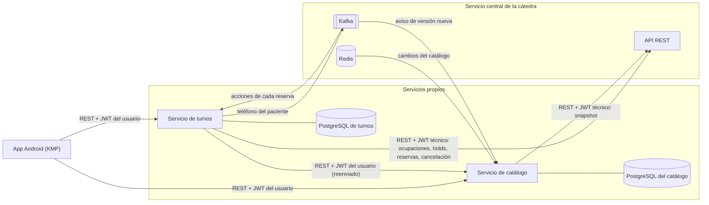
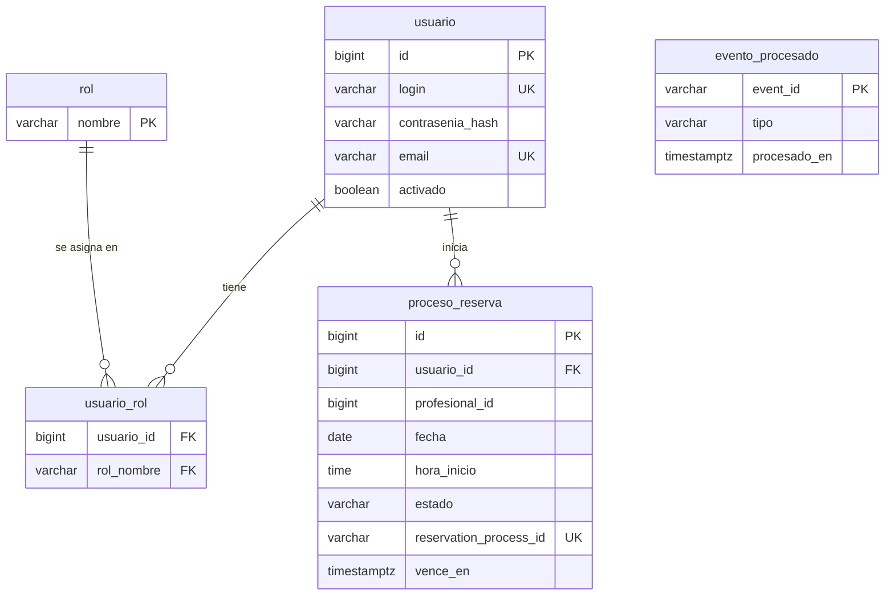

<!-- calidad:inicio -->
  

**Calidad (7 dimensiones):** sin código en `main` (no evaluable).
<!-- calidad:fin -->

# Servicio de turnos

Servicio backend del sistema de turnos médicos. Maneja las cuentas de usuario, arma la disponibilidad de cada profesional y lleva adelante las reservas contra el servicio central de la cátedra.

Forma parte de un sistema con una app Android, este servicio y el servicio de catálogo, integrado con el servicio central de la cátedra (ver [Arquitectura](#arquitectura)).

## Qué hace el servicio

- **Registra usuarios e inicia sesión**, con contraseñas guardadas con Argon2id y un JWT propio para la app.
- **Arma los turnos libres** de un profesional combinando su agenda, que pide al servicio de catálogo, con las ocupaciones que informa la cátedra.
- **Reserva turnos** contra la cátedra (REST y Kafka) y guarda el estado de cada proceso a nombre del usuario que lo inició.

El resto del sistema (servicio de catálogo, app y documentación) vive en repositorios aparte.

## Arquitectura



- **La app** solo habla con los servicios propios, nunca con la cátedra. En cada pedido manda el JWT del usuario que emite turnos.
- **Turnos** es dueño de las cuentas de usuario y de los procesos de reserva, y es el único que escribe en su base. Para la agenda le pregunta al catálogo, reenviando el JWT del usuario; para las ocupaciones y las reservas habla con la cátedra con el JWT técnico. Recibe por Kafka el resultado de cada reserva y publica ahí el teléfono del paciente.
- **El catálogo** guarda una copia de categorías, profesionales y horarios, y la mantiene al día con la cátedra (snapshot por REST, cambios por Redis y avisos por Kafka). Valida el mismo JWT de usuario con la clave compartida `JWT_SECRETO`.
- **Cada servicio tiene su propia base** y no lee la del otro: si necesita un dato, se lo pide por la API.
- **Dos identidades que no se mezclan:** el JWT del usuario circula entre la app y los servicios propios; el JWT técnico de la cátedra lo usa solo el backend y nunca llega a la app.

## Tecnologías

| Tecnología | Uso |
|---|---|
| Java 21 | Lenguaje |
| Spring Boot 4.1.2 | Aplicación web, JPA, validación, Actuator y tareas programadas |
| Spring Security + OAuth2 Resource Server | Validación del JWT de los usuarios y roles |
| Argon2id (Bouncy Castle) | Hash de las contraseñas |
| Spring Kafka | Eventos de la cátedra y publicación del teléfono |
| RestClient | Llamadas al catálogo y a la cátedra, con timeouts |
| Maven (wrapper `mvnw`) | Compilación y dependencias |
| PostgreSQL 17 | Base de datos |
| Flyway | Migraciones del esquema |
| Docker Compose | Base de datos local |
| JUnit 5, Mockito y Testcontainers | Pruebas unitarias y de integración contra un PostgreSQL real y temporal |
| Kafka embebido (`spring-kafka-test`) | Pruebas de los eventos sin la cátedra |
| JaCoCo y SonarCloud | Cobertura y análisis de calidad en cada pull request |
| Postman y Newman | Pruebas de la API de punta a punta |
| Lombok | Menos código repetitivo en las entidades JPA |

## Requisitos

- JDK 21.
- Docker con Docker Compose (para la base local y para las pruebas).
- No hace falta instalar Maven: `./mvnw` descarga la versión correcta. En Windows se usa `mvnw.cmd`.

## Configuración

Copiar el archivo de ejemplo y cambiar las contraseñas:

```bash
cp .env.example .env
```

| Variable | Para qué sirve |
|---|---|
| `POSTGRES_DB` | Nombre de la base de turnos |
| `POSTGRES_USER` | Usuario de esa base |
| `POSTGRES_PASSWORD` | Contraseña de ese usuario |
| `DB_PORT` | Puerto local donde se publica PostgreSQL (por defecto `5434`) |
| `SPRING_DATASOURCE_URL` | URL de conexión del servicio, por ejemplo `jdbc:postgresql://localhost:5434/turnos` |
| `SPRING_DATASOURCE_USERNAME` | Usuario con el que se conecta el servicio |
| `SPRING_DATASOURCE_PASSWORD` | Contraseña con la que se conecta el servicio |
| `SERVER_PORT` | Puerto del servicio (por defecto `8081`, para no chocar con el catálogo en `8080`) |
| `CATALOGO_API_URL` | URL del servicio de catálogo (por defecto `http://localhost:8080`) |
| `JWT_SECRETO` | Clave con la que turnos firma el JWT de los usuarios (HS256). Mínimo 32 caracteres |
| `JWT_DURACION` | Cuánto dura el JWT de los usuarios (por defecto `1h`) |
| `CORS_ORIGENES_PERMITIDOS` | Orígenes de navegador que pueden llamar a turnos, separados por coma. Vacía por defecto (ver [CORS](#cors)) |

- El puerto de `SPRING_DATASOURCE_URL` tiene que coincidir con `DB_PORT`.
- El puerto por defecto es `5434` para no chocar con PostgreSQL instalado en la máquina (`5432`) ni con la base del catálogo (`5433`).
- La base y el usuario son solo de turnos: cada servicio tiene su propio contenedor, así que turnos no tiene acceso a la base del catálogo.
- `JWT_SECRETO` se genera una vez con `openssl rand -base64 48`. Si falta o tiene menos de 32 caracteres, el servicio no arranca. El catálogo usa la misma clave para validar los tokens.
- `.env` no se versiona. Docker Compose lo lee solo; Spring Boot no, por eso se carga a mano al ejecutar el servicio (ver más abajo).

## Cuentas de usuario

Turnos es el dueño de las cuentas de la app y emite su JWT. Las contraseñas se guardan con **Argon2id** y nunca aparecen en respuestas ni en logs.

### Registrarse

```bash
curl -X POST http://localhost:8081/api/v1/cuenta/registro \
  -H "Content-Type: application/json" \
  -d '{"login": "ana", "password": "una-clave", "firstName": "Ana", "lastName": "Gomez",
       "email": "ana@mail.com", "langKey": "es"}'
```

| Campo | Regla |
|---|---|
| `login` | Obligatorio, hasta 50 caracteres: letras, números y `_.@-` |
| `password` | Obligatoria, entre 4 y 100 caracteres |
| `email` | Obligatorio y válido, entre 5 y 254 caracteres |
| `firstName`, `lastName` | Opcionales, hasta 50 caracteres |
| `imageUrl` | Opcional, hasta 256 caracteres |
| `langKey` | Opcional, entre 2 y 10 caracteres (por defecto `es`) |

- Responde `201` con `{"id_token": "...", "venceEn": "..."}`: la cuenta queda activa y con la sesión iniciada.
- `login` y `email` se guardan en minúsculas. Si ya existen, responde `409` (`login-repetido` o `email-repetido`).
- Id, estado, roles y auditoría los decide el servicio: la cuenta nace activa y con `ROLE_USER`.

### Iniciar sesión

```bash
curl -X POST http://localhost:8081/api/v1/cuenta/login \
  -H "Content-Type: application/json" \
  -d '{"username": "ana", "password": "una-clave"}'
```

- Usa los mismos nombres de campo que JHipster y que `/api/authenticate` de la cátedra (`rememberMe` se acepta y se ignora).
- Responde `200` con `{"id_token": "...", "venceEn": "..."}`, igual que el registro.
- Usuario inexistente, contraseña errónea o cuenta inactiva responden lo mismo: `401` `credenciales-invalidas` con "Usuario o contraseña incorrectos". Así no se puede averiguar qué cuentas existen.
- Si el usuario no existe se calcula igual un hash Argon2id de relleno, para que la respuesta tarde lo mismo que con una contraseña errónea.

### El JWT de los usuarios

| Dato | Contenido |
|---|---|
| `sub` | login del usuario |
| `userId` | id del usuario en turnos |
| `auth` | roles separados por espacio, por ejemplo `ROLE_USER` |
| `iss` | `servicio-turnos` |
| `iat`, `exp` | emisión y vencimiento |

Es distinto del JWT técnico de la cátedra: ese solo lo usa el backend y nunca llega a la app.

## Autenticación

Todas las APIs piden el JWT del usuario, salvo `POST /api/v1/cuenta/registro`, `POST /api/v1/cuenta/login` y `GET /actuator/health`. El token va en cada pedido:

```bash
curl http://localhost:8081/api/v1/cuenta -H "Authorization: Bearer <id_token>"
```

- Se valida la firma (HS256 con `JWT_SECRETO`), el vencimiento (`exp`), el emisor (`iss = servicio-turnos`) y que tenga el rol `ROLE_USER`.
- El servicio no guarda sesiones: cada pedido se valida solo con su token.
- El usuario siempre se toma del token (`sub`), nunca de un dato que mande el cliente.
- `GET /api/v1/cuenta` devuelve los datos de la cuenta del usuario del token (login, nombre, email, idioma, roles), nunca el hash de la contraseña.

| Situación | Status | `type` |
|---|---|---|
| Sin token | 401 | `no-autenticado` |
| Token con firma incorrecta, vencido o de otro emisor | 401 | `token-invalido` |
| Token válido sin el rol necesario | 403 | `sin-permiso` |

Con `token-invalido` la app tiene que volver a iniciar sesión.

## CORS

CORS es una regla que aplica el navegador: no deja que una página de un dominio llame a otro salvo que el servidor lo permita. La app Android no es un navegador, así que no lo necesita. Por eso, por defecto, **ningún origen de navegador está permitido**.

- Si algún día hace falta un cliente web, su origen se agrega en `CORS_ORIGENES_PERMITIDOS` (por ejemplo `https://panel.ejemplo.com`; varios, separados por coma).
- Aun así, solo se permiten los métodos que usa la API (`GET` y `POST`) y los headers `Authorization` y `Content-Type`.
- Un pedido de un origen no permitido responde `403 origen-no-permitido`. Los pedidos sin `Origin` (la app) no cambian.

## Errores

Todos los errores responden `application/problem+json` (RFC 7807) con `type`, `title`, `status`, `detail` e `instance`. El `type` es `urn:turnos:error:<codigo>`, por ejemplo `urn:turnos:error:datos-invalidos`. El `title` y el `detail` están en español. Ningún error muestra trazas ni datos internos: un error inesperado responde `500 error-interno` con un texto genérico y la traza queda solo en el log.

Los datos de entrada se validan en los controllers, antes de llegar a los casos de uso:

| Error | Status | `type` | Ejemplo de `detail` |
|---|---|---|---|
| Un campo del cuerpo no cumple su regla | 400 | `datos-invalidos` | `Datos inválidos. profesionalId: debe ser mayor a 0` |
| El cuerpo no es un JSON válido | 400 | `parametro-invalido` | `El cuerpo del pedido no es un JSON válido` |
| Un parámetro de la URL no cumple su regla | 400 | `parametro-invalido` | `Parámetros inválidos. id: debe ser mayor a 0` |
| Un parámetro con un tipo que no corresponde | 400 | `parametro-invalido` | `El parámetro 'fecha' tiene que ser una fecha con el formato AAAA-MM-DD` |
| Falta un parámetro obligatorio | 400 | `parametro-invalido` | `Falta el parámetro obligatorio 'fecha'` |
| Ruta inexistente | 404 | `ruta-no-encontrada` | `No existe la ruta /api/v1/otra` |
| Método no permitido | 405 | `metodo-no-permitido` | `El método DELETE no está permitido en esta ruta` |

- Los ids (`{id}`, `categoriaId`, `profesionalId`) tienen que ser mayores a 0.
- En el login, `username` puede tener hasta 50 caracteres y `password` hasta 100, los mismos límites que el registro.
- El `detail` nombra el campo o el parámetro que falló, pero no repite el valor recibido.

## Consulta al catálogo

Turnos no guarda copia del catálogo. Cada vez que necesita los datos de un profesional se los pide al servicio de catálogo con `GET /api/v1/profesionales/{id}` (ADR 0002 del catálogo): el profesional, sus horarios semanales habilitados y la `versionCatalogo` con la que se validan los turnos.

- En cada pedido se reenvía el JWT del usuario que lo originó (`Authorization: Bearer ...`), así el catálogo sabe quién hizo la consulta (ADR 0003).
- Si el catálogo tarda más de 2 segundos en aceptar la conexión o más de 5 en responder, se corta el pedido. Se configura con `catalogo.api.timeout-conexion` y `catalogo.api.timeout-lectura`.
- Si el catálogo no responde, la operación que lo necesita no se inicia.

| Respuesta del catálogo | Respuesta de turnos | `type` |
|---|---|---|
| `200` | Sigue con los datos del profesional | — |
| `404` | `404` | `profesional-no-encontrado` |
| `409` | `409` | `profesional-deshabilitado` |
| `401` o `403` | `503`, y queda un error en el log: la configuración entre los dos servicios no coincide (por ejemplo, `JWT_SECRETO` distinto) | `catalogo-no-disponible` |
| Otro error, timeout o sin conexión | `503` | `catalogo-no-disponible` |

## Disponibilidad

La disponibilidad (CU-03) junta la agenda vigente del catálogo con las ocupaciones de la cátedra. Disponible significa tener al menos un turno libre, como aclaró el profesor; por eso el filtro vive en turnos y no en el catálogo. Los dos endpoints exigen el JWT del usuario.

| Endpoint | Qué devuelve |
|---|---|
| `GET /api/v1/disponibilidad/profesionales/{id}?fecha=2026-11-03` | Los turnos libres de un profesional en esa fecha |
| `GET /api/v1/disponibilidad/profesionales?categoriaId=1&fecha=2026-11-03` | Los profesionales habilitados de la categoría con al menos un turno libre, y cuántos tiene cada uno |

```json
{
  "profesionalId": 15,
  "fecha": "2026-11-03",
  "versionCatalogo": 7,
  "turnos": [{ "horaInicio": "09:00", "horaFin": "09:30" }]
}
```

Cómo se arman los turnos libres:

1. Se pide al catálogo el profesional con su agenda.
2. Los horarios del día de la semana de la fecha se parten en turnos de `duracionTurnoMinutos`. Si sobra un pedazo que no llega a un turno entero, no se ofrece.
3. Se piden a la cátedra las ocupaciones de ese día y se quitan los turnos `CONFIRMED` y los `HELD` vigentes. Un `HELD` cuyo `expiresAt` ya pasó cuenta como libre.
4. Se quitan los turnos que ya empezaron, comparando con la hora actual en `turnos.zona-horaria` (por defecto `America/Argentina/Buenos_Aires`), porque los horarios de la agenda son hora local.

- Si el profesional no atiende ese día de la semana, la lista viene vacía y no se le pregunta a la cátedra.
- Una fecha anterior a hoy responde `400` (`fecha-pasada`). Hoy se puede consultar: solo aparecen los turnos que todavía no empezaron.
- Un profesional inexistente responde `404` y uno deshabilitado `409`. Si el catálogo o la cátedra no responden, `503`.
- En el filtro, los profesionales de la categoría se leen de todas las páginas del catálogo. Si alguno se deshabilita o desaparece mientras se arma la lista, no se muestra. Si el catálogo o la cátedra no responden, falla toda la búsqueda: una lista parcial haría creer que los que faltan no tienen turnos.

## Reservas

### Iniciar una reserva

`POST /api/v1/reservas` inicia el proceso de reserva de un turno libre (CU-04). Exige el JWT del usuario: el usuario sale siempre del token, nunca del cuerpo.

```json
{ "profesionalId": 15, "fecha": "2026-11-03", "horaInicio": "09:00" }
```

Pasos, en orden:

1. La cuenta tiene que tener nombre y apellido de al menos 2 caracteres, porque la cátedra los exige. Si no, `400 datos-de-cuenta-incompletos`.
2. Un usuario puede tener **un solo proceso abierto** a la vez. Si ya tiene uno, `409 proceso-abierto`.
3. Se vuelve a validar con el catálogo y la cátedra que el turno siga libre (la misma regla que la disponibilidad). Si no, `409 turno-no-disponible`.
4. Se registra el proceso a nombre del usuario en estado `INICIADO`, **antes** de llamar a la cátedra.
5. Se pide el hold a la cátedra (`POST /api/appointment-holds`) y se guardan `holdId`, `reservationProcessId` y `expiresAt`. Como `externalPatientId` se manda el id del usuario en turnos.
6. Se confirma inicialmente el hold (`POST /api/appointment-holds/{holdId}/confirm`) con el nombre y apellido de la cuenta. El proceso queda `ESPERANDO_TELEFONO`.

Cada paso se guarda apenas ocurre, sin una transacción que los agrupe: si la cátedra ya creó el hold y después falla la confirmación, el proceso conserva el `holdId`.

| Qué pasa | Estado del proceso | Respuesta |
|---|---|---|
| Todo bien | `ESPERANDO_TELEFONO` | `201` con el proceso |
| La cátedra no contesta (timeout, sin conexión, `5xx` o respuesta incompleta) | `INCIERTO` | `202` con el proceso |
| `SLOT_ALREADY_HELD` / `SLOT_ALREADY_RESERVED` | `RECHAZADO` | `409 turno-ocupado` |
| `INVALID_SLOT`, `PROFESSIONAL_NOT_FOUND`, `PROFESSIONAL_DISABLED` | `RECHAZADO` | `409 turno-no-disponible` |
| `HOLD_EXPIRED` | `VENCIDO` | `409 proceso-vencido` |
| Problema de la cuenta técnica (`401`, `403`, `STUDENT_INTEGRATION_NOT_FOUND`) | `RECHAZADO` | `503 catedra-no-disponible` |
| Otro rechazo de la cátedra | `RECHAZADO` | `409 reserva-rechazada` |

```json
{
  "id": 100,
  "estado": "ESPERANDO_TELEFONO",
  "abierto": true,
  "profesionalId": 15,
  "fecha": "2026-11-03",
  "horaInicio": "09:00",
  "venceEn": "2026-11-02T12:15:00Z",
  "motivo": null,
  "puedeEnviarTelefono": false
}
```

- **Un timeout no es un rechazo:** la cátedra pudo haber retenido el turno. Por eso no se reintenta a ciegas: el proceso queda `INCIERTO` y lo resuelve la recuperación (CU-10), que primero consulta el estado.
- **Un solo proceso abierto**, como acordamos con el profesor: además del chequeo en el servicio, un índice único parcial en PostgreSQL (`ux_proceso_abierto_por_usuario`) impide guardar dos procesos abiertos del mismo usuario aunque lleguen dos pedidos a la vez. `INCIERTO` cuenta como abierto.
- **No se cancela un hold:** si el usuario se arrepiente antes de mandar el teléfono, el hold se deja vencer y el proceso termina como `VENCIDO`. Guardar `venceEn` no extiende el hold.
- Los identificadores de la cátedra (`holdId`, `reservationProcessId`) no se le muestran a la app.

### Enviar el teléfono

Después de la confirmación inicial, la cátedra pide el teléfono del paciente por Kafka (CU-05):

```
cátedra ──AdditionalInformationRequested──▶ turnos      (topic de acciones)
app ──POST /api/v1/reservas/{id}/telefono──▶ turnos
turnos ──AdditionalInformationSubmitted──▶ cátedra      (topic de teléfono, key = reservationProcessId)
cátedra ──AdditionalInformationRejected──▶ turnos       (si el teléfono no sirve; se puede corregir)
```

1. Al recibir `AdditionalInformationRequested`, turnos busca el proceso por `reservationProcessId`, guarda el `eventId` del pedido y el nuevo `expiresAt`, y lo deja `ESPERANDO_TELEFONO`. Si el proceso estaba `INCIERTO`, el pedido demuestra que la confirmación llegó a la cátedra.
2. La app manda el teléfono:

   ```json
   { "telefono": "+54 261 555-1234" }
   ```

3. Turnos controla que el proceso sea del usuario del token, que esté esperando el teléfono y que no haya vencido. Le saca espacios, guiones, paréntesis y puntos y valida el formato de la cátedra: `^\+?[0-9]{7,15}$`.
4. Publica `AdditionalInformationSubmitted` con un `eventId` nuevo, el `eventId` del pedido como `requestEventId` y `CATEDRA_GROUP_ID` como `groupId`. La message key es el `reservationProcessId`, así todos los eventos de un proceso llegan en orden. Espera hasta 10 segundos a que Kafka confirme el envío y recién ahí marca el proceso `TELEFONO_ENVIADO`.
5. Si llega `AdditionalInformationRejected`, el proceso pasa a `TELEFONO_RECHAZADO` y el usuario puede corregir el teléfono y mandarlo otra vez, con otro `eventId`, hasta que venza.

| Caso | Respuesta |
|---|---|
| Teléfono publicado | `202` con el proceso en `TELEFONO_ENVIADO` |
| El proceso no existe o es de otro usuario | `404 proceso-no-encontrado` |
| El proceso no está esperando el teléfono | `409 telefono-no-pedido` |
| Ya pasó `venceEn` | se marca `VENCIDO` y responde `409 proceso-vencido` |
| Formato inválido | `400 telefono-invalido` |
| Kafka no confirma el envío | `503 mensajeria-no-disponible`; el proceso no cambia y se puede reintentar |

- **El teléfono no se guarda en turnos:** es un dato personal que solo necesita la cátedra. Tampoco aparece en el log.
- Un proceso de otro usuario responde `404`, no `403`, para no revelar que existe.
- Un evento que no corresponde (proceso desconocido, ya terminado o en otro paso) se deja en el log y no se aplica: un evento tardío no reabre un proceso cerrado.
- El listener solo se crea si `CATEDRA_KAFKA_BOOTSTRAP_SERVERS`, `CATEDRA_KAFKA_CONSUMER_GROUP` y `CATEDRA_KAFKA_TOPIC_ACCIONES` están configuradas. Si falla al procesar un evento, se reintenta 3 veces con 5 segundos de espera; el offset se confirma recién cuando el evento se procesó.

### Resultado de la reserva

La cátedra informa el resultado final de cada proceso por el topic de acciones (CU-06):

| Evento | Estado del proceso | Qué se guarda |
|---|---|---|
| `AppointmentConfirmed` | `CONFIRMADO` | el `reservationId` de la cátedra |
| `AppointmentProcessExpired` | `VENCIDO` | — |
| `AppointmentProcessInvalid` | `INVALIDO` | el motivo (`reason`) |
| `AppointmentCancelled` | `CANCELADO` | el motivo, si viene |

- **Sin duplicados:** cada evento del topic de acciones (también el pedido y el rechazo del teléfono) registra su `eventId` en la tabla `evento_procesado`, en la misma transacción que el cambio del proceso. Si el `eventId` ya estaba, el evento se descarta sin efectos. Si algo falla, no queda ni el `eventId` ni el cambio, y Kafka lo reintenta. El offset se confirma recién después de guardar.
- **Un estado final no retrocede:** un evento tardío sobre un proceso `VENCIDO`, `INVALIDO`, `CANCELADO` o `RECHAZADO` queda en el log y no lo reabre. Hay dos excepciones:
  - `CONFIRMADO` → `CANCELADO`: cancelar una reserva confirmada es avanzar.
  - `VENCIDO` → `CONFIRMADO`, solo si la cátedra confirma un proceso que turnos había dado por vencido por su cuenta (comparando con `venceEn`). La cátedra tiene la última palabra: si confirmó, el turno existe.
- **Eventos fuera de orden:** cada evento se aplica solo si tiene sentido en el estado actual. Un vencimiento que llega después de la confirmación no la deshace; una cancelación que llega antes que la confirmación gana.

### Consultar un proceso

La app consulta en qué paso está su reserva (CU-07), por ejemplo después de un `202` o mientras espera el resultado:

| Endpoint | Qué devuelve |
|---|---|
| `GET /api/v1/reservas/{id}` | El proceso con ese id |
| `GET /api/v1/reservas/en-curso` | El único proceso abierto del usuario, para retomarlo si la app se cerró y no tiene el id |

```json
{
  "id": 100,
  "estado": "TELEFONO_RECHAZADO",
  "abierto": true,
  "profesionalId": 15,
  "fecha": "2026-11-03",
  "horaInicio": "09:00",
  "venceEn": "2026-11-02T12:20:00Z",
  "motivo": null,
  "puedeEnviarTelefono": true
}
```

- `venceEn` aparece solo mientras el proceso sigue abierto; en uno terminado es `null`.
- `motivo` es el que informó la cátedra al invalidar o cancelar, o el que puso el usuario al cancelar.
- `abierto` y `puedeEnviarTelefono` le dicen a la app qué puede hacer, sin que tenga que repetir las reglas de los estados.
- Un usuario solo ve sus propios procesos: uno ajeno responde `404 proceso-no-encontrado`, igual que uno inexistente, para no revelar que existe. Sin proceso abierto, `en-curso` responde `404 sin-proceso-en-curso`.
- La respuesta es la misma que devuelven `POST /api/v1/reservas`, `POST /api/v1/reservas/{id}/telefono` y `POST /api/v1/reservas/{id}/cancelar`. Nunca incluye los identificadores de la cátedra.

### Mis reservas

`GET /api/v1/reservas` devuelve las reservas del usuario (CU-08), combinando lo que guarda turnos con lo que informa la cátedra (`GET /api/appointments`, contrato, sección 11).

```json
{
  "reservas": [
    {
      "procesoId": 100,
      "estado": "CONFIRMADO",
      "fecha": "2026-11-03",
      "horaInicio": "09:00",
      "horaFin": "09:30",
      "profesional": { "id": 15, "nombre": "Ana", "apellido": "Gomez" },
      "confirmadaEn": "2026-11-02T12:05:00Z",
      "canceladaEn": null,
      "motivoCancelacion": null
    }
  ],
  "desactualizado": false
}
```

- **Aislamiento entre usuarios:** la cátedra solo conoce la cuenta técnica, así que guarda juntas las reservas de todos los usuarios de turnos. Turnos le pide las del usuario (`externalPatientId`) y además vuelve a filtrar cada reserva que recibe: aunque la cátedra mande una ajena, nunca se muestra.
- **Qué se lista:** solo reservas de verdad, las que la cátedra registró (esperando el teléfono, confirmadas o canceladas). Los procesos que nunca llegaron a ser reserva no aparecen; el proceso en curso se consulta con `/en-curso`.
- **Cómo se combinan:** por `reservationProcessId`. Si turnos y la cátedra no coinciden, se muestra lo de la cátedra, sin cambiar la base (eso lo corrige la recuperación). Mientras se espera el teléfono se muestra el paso local, que es más preciso. Una reserva que solo conoce la cátedra sale con `procesoId: null`; una que solo conoce turnos sale sin nombre del profesional ni hora de fin.
- **Si la cátedra no responde:** se responde `200` igual, con lo guardado en turnos y `"desactualizado": true`, para que la app avise que puede faltar algo reciente.
- Nunca se muestran los identificadores de la cátedra ni el nombre y teléfono del paciente que devuelve la cátedra.

### Cancelar una reserva

`POST /api/v1/reservas/{id}/cancelar` cancela una reserva confirmada del usuario (CU-09). `{id}` es el del proceso, el mismo de `GET /api/v1/reservas/{id}` y el `procesoId` de "mis reservas". El body es opcional:

```json
{ "motivo": "No puedo ir" }
```

El motivo puede tener hasta 500 caracteres y se le pasa a la cátedra. Responde `200` con el proceso en `CANCELADO`.

1. Si el proceso no existe o es de otro usuario, responde `404 proceso-no-encontrado`, igual que al consultarlo.
2. Si ya está `CANCELADO`, responde `200` con el proceso sin volver a llamar a la cátedra: cancelar dos veces no es un error.
3. Si no está `CONFIRMADO`, responde `409 reserva-no-cancelable`. Un turno retenido que todavía no se confirmó no se cancela: se deja vencer.
4. Le pide la cancelación a la cátedra (`POST /api/appointments/{reservationProcessId}/cancel`, contrato, sección 12) con el JWT técnico. La cátedra la trata como idempotente.

| Respuesta de la cátedra | Resultado |
|---|---|
| `200` con `CANCELLED` | `200`, el proceso queda `CANCELADO` |
| `409 RESERVATION_NOT_CANCELLABLE` | `409 reserva-no-cancelable`, sigue `CONFIRMADO` |
| Timeout, sin conexión o `5xx` | Se verifica antes de responder (ver abajo) |
| Otro rechazo (`RESERVATION_NOT_FOUND`, `RESERVATION_OWNER_MISMATCH`, cuenta técnica) | `503 catedra-no-disponible`, sigue `CONFIRMADO` y queda un error en el log |

- **Un timeout no se informa como cancelación hecha:** la cátedra pudo haberla cancelado o no. Turnos consulta la reserva en la cátedra (`GET /api/appointments`): si figura `CANCELLED`, el proceso queda `CANCELADO` y responde `200`; si sigue confirmada o la consulta también falla, responde `503 cancelacion-no-confirmada` y el proceso sigue `CONFIRMADO`. Reintentar es seguro porque cancelar es idempotente.
- **Lo que llegue primero:** la cátedra también publica `AppointmentCancelled`. Si el evento llega antes que la respuesta, el proceso ya está `CANCELADO` y la respuesta no lo vuelve a tocar; si llega después, el evento se ignora porque el proceso ya terminó.
- Turnos nunca marca una reserva como cancelada sin que la cátedra lo confirme, ya sea por la respuesta, por la verificación o por el evento.

### Estados de un proceso

| Estado | Cuándo | ¿Es final? |
|---|---|---|
| `INICIADO` | se registró el proceso y se está pidiendo el hold | no |
| `ESPERANDO_TELEFONO` | la cátedra aceptó la confirmación inicial | no |
| `TELEFONO_ENVIADO` | se publicó el teléfono y se espera el resultado | no |
| `TELEFONO_RECHAZADO` | la cátedra rechazó el teléfono; se puede corregir hasta que venza | no |
| `INCIERTO` | la cátedra no contestó y no se sabe el resultado; lo resuelve la [recuperación](#recuperación-de-procesos-pendientes) | no |
| `CONFIRMADO` | la cátedra confirmó la reserva | sí (solo puede pasar a `CANCELADO`) |
| `VENCIDO` | venció el hold | sí |
| `INVALIDO` | la cátedra invalidó el proceso | sí |
| `CANCELADO` | se canceló la reserva | sí |
| `RECHAZADO` | la cátedra rechazó el hold | sí |

Un estado final no cambia más: un proceso terminado no se reabre.

### Recuperación de procesos pendientes

Un proceso puede quedar a medias: un timeout al crear o confirmar el hold (`INCIERTO`), un reinicio del servicio en medio de una reserva o un evento de la cátedra que nunca llegó. Mientras siga abierto, el usuario no puede iniciar otra reserva. La recuperación los resuelve (CU-10).

Corre apenas arranca el servicio y después cada `turnos.recuperacion.intervalo` (por defecto `1m`), contado desde que termina la ronda anterior, así dos rondas nunca se superponen. Revisa solo los procesos abiertos y, por cada usuario, consulta una sola vez sus reservas en la cátedra (`GET /api/appointments`) con los identificadores guardados:

| Situación | Resultado |
|---|---|
| La cátedra informa la reserva `CONFIRMED` | `CONFIRMADO`, con su `reservationId` |
| La cátedra informa `CANCELLED` | `CANCELADO` |
| La cátedra informa `FAILED` | `INVALIDO` |
| `PHONE_PENDING`, o todavía no figura, y no venció | Sin cambios: lo resuelve el evento de Kafka |
| Pasó `venceEn` más `turnos.recuperacion.margen` (`2m`) sin resultado final | `VENCIDO` |
| Sin hold (no hay `venceEn`) y pasó `turnos.recuperacion.espera-sin-hold` (`15m`) desde que se creó | `VENCIDO`, sin consultar a la cátedra |

- **Nunca repite efectos:** solo consulta. No vuelve a crear ni a confirmar un hold, así que no puede duplicar una reserva.
- **Nunca reabre un estado final.** Si un evento cambia el proceso mientras se revisa, se deja lo del evento.
- **Reintentos limitados y en el log:** cada proceso se revisa una vez por ronda. Si la cátedra no responde, queda un `warn` y se reintenta en la ronda siguiente; los que ya vencieron se cierran igual. Como todo proceso termina cerrándose al vencer, los intentos tienen un límite. Cada cambio queda en el log y cada ronda termina con un resumen (revisados, resueltos y pendientes).
- **La cátedra tiene la última palabra:** si se cerró como `VENCIDO` un proceso que la cátedra sí confirmó, el evento `AppointmentConfirmed` lo pasa a `CONFIRMADO`.
- En las pruebas la ejecución periódica está apagada (`turnos.recuperacion.habilitada=false`) y la recuperación se prueba llamando al servicio directo.

## Integración con la cátedra

El servicio reserva turnos contra el servicio central de la cátedra por REST y Kafka. Usa la misma cuenta técnica que el servicio de catálogo: se da de alta una sola vez, a mano, y los dos servicios comparten el JWT técnico (contrato de integración, sección 2).

La respuesta del alta (`POST /api/student/register`) o de `GET /api/student/integration` trae el `id_token` y el objeto `integration`. Esos valores se copian al `.env`:

| Variable | Campo de la respuesta |
|---|---|
| `CATEDRA_API_URL` | URL base de la API (la entrega la cátedra) |
| `CATEDRA_JWT` | `id_token` |
| `CATEDRA_KAFKA_BOOTSTRAP_SERVERS` | `integration.kafkaBootstrapServers` |
| `CATEDRA_KAFKA_CONSUMER_GROUP` | `integration.kafkaConsumerGroupId` (el grupo con el que turnos lee el topic de acciones) |
| `CATEDRA_KAFKA_TOPIC_ACCIONES` | `integration.kafkaAppointmentActionsTopic` (eventos que publica la cátedra sobre cada reserva) |
| `CATEDRA_KAFKA_TOPIC_TELEFONO` | `integration.kafkaAppointmentPhoneTopic` (donde turnos publica el teléfono del paciente) |
| `CATEDRA_GROUP_ID` | `integration.groupId` (va en cada evento que publica turnos) |

- Estos valores son credenciales: van solo en `.env` y nunca en el código, en los logs ni en este README.
- El JWT técnico lo usa solo el backend para hablar con la cátedra; nunca llega a la app.
- Si las variables están vacías el servicio arranca igual, pero no puede reservar turnos.

### Ocupaciones de un profesional

Para saber qué turnos ya están tomados, turnos le pide a la cátedra las ocupaciones de un profesional en una fecha (`GET /api/appointment-occupancies`, contrato, sección 8), con el JWT técnico. El JWT del usuario nunca se manda a la cátedra.

- Cada ocupación trae fecha, hora de inicio y estado: `CONFIRMED` (reservado) o `HELD` (retenido hasta `expiresAt`). Una lista vacía es válida: el profesional tiene todo libre.
- Si un mismo turno aparece como `CONFIRMED` y como `HELD`, prevalece `CONFIRMED`. Las ocupaciones incompletas o con un estado desconocido se ignoran.
- Los timeouts son los de `catedra.api.timeout-conexion` (5s) y `catedra.api.timeout-lectura` (30s).
- Los errores se distinguen por el `code` de la respuesta, porque el mismo status puede significar cosas distintas:

| Respuesta de la cátedra | Respuesta de turnos | `type` |
|---|---|---|
| `404 PROFESSIONAL_NOT_FOUND` | `404` | `profesional-no-encontrado` |
| `400 PROFESSIONAL_DISABLED` | `409` | `profesional-deshabilitado` |
| `401`, `403` o `STUDENT_INTEGRATION_NOT_FOUND` | `503`, y queda un error en el log para revisar `CATEDRA_JWT` | `catedra-no-disponible` |
| Otro error, timeout o sin conexión | `503` | `catedra-no-disponible` |

Ni los errores que ve la app ni el log muestran la URL de la cátedra ni el token: en el log queda solo el status y el `code`.

## Base de datos con Docker Compose

```bash
docker compose up -d
docker compose ps
```

Levanta PostgreSQL con los datos de `.env`. Cuando `docker compose ps` muestra el contenedor como `healthy`, la base ya acepta conexiones. Los datos se guardan en el volumen `turnos-postgres-data`, así que se conservan al detener o recrear el contenedor.

```bash
docker compose down        # detiene el contenedor y conserva los datos
docker compose down -v     # además borra los datos
```

Cambiar las contraseñas en `.env` no modifica las de una base ya creada: hay que borrar el volumen o cambiarlas dentro de PostgreSQL.

## Ejecutar el servicio

Con la base levantada, cargar las variables y ejecutar:

```bash
set -a
. ./.env
set +a
./mvnw spring-boot:run
```

Desde IntelliJ se pueden definir las variables `SPRING_DATASOURCE_*` en la configuración de ejecución de `ServicioTurnosApplication`.

### Comprobar que funciona

```bash
curl http://localhost:8081/actuator/health
```

La respuesta esperada es `{"status":"UP"}`: el servicio está en marcha y llega a la base. Es el único endpoint de Actuator que se expone y no muestra detalles internos.

## Pruebas

```bash
./mvnw verify
```

Compila, ejecuta las pruebas y genera el reporte de cobertura. Las pruebas levantan un PostgreSQL 17 temporal con Testcontainers, por lo que Docker tiene que estar en marcha. No usan `.env` ni la base de desarrollo.

Hay pruebas unitarias del dominio y de cada caso de uso, de los controllers (con MockMvc), de los clientes REST (con un servidor simulado), de la persistencia contra PostgreSQL y de Kafka con un broker embebido.

| Área | Pruebas | Qué comprueban |
|---|---|---|
| Arranque y base | `ServicioTurnosApplicationTests`, `MigracionFlywayTests`, `EndpointSaludTests` | Que la aplicación arranca, que Flyway aplica todas las migraciones y que el health responde `UP` sin detalles |
| Errores | `ManejadorErroresApiTests` | El formato ProblemDetail de cada error, en español y sin trazas |
| Seguridad | `SeguridadIntegracionTests`, `CorsIntegracionTests`, `CorsPropertiesTests`, `JwtPropertiesTests`, `EmisorTokensJwtTests` | Tokens reales, alterados, vencidos, de otro emisor y sin rol; orígenes permitidos y rechazados; clave mínima del JWT |
| Cuentas | `UsuarioTests`, `RegistrarUsuarioServiceTests`, `IniciarSesionServiceTests`, `ConsultarCuentaServiceTests`, `CifradorArgon2idTests`, `UsuarioPersistenciaTests`, `CuentaControllerTests` | Registro, login, consulta de la cuenta y hash de la contraseña |
| Disponibilidad | `CalculadoraTurnosLibresTests`, `ConsultarTurnosLibresServiceTests`, `BuscarProfesionalesConTurnosLibresServiceTests`, `CatalogoRestAdapterTests`, `OcupacionesCatedraRestAdapterTests`, `DisponibilidadControllerTests` | Cálculo de turnos libres, fechas pasadas, ocupaciones y errores del catálogo y la cátedra |
| Reservas | `ProcesoReservaTests`, `ProcesoReservaTelefonoTests`, `ProcesoReservaResultadoTests`, `TelefonoTests`, `IniciarReservaServiceTests`, `EnviarTelefonoServiceTests`, `ConsultarProcesoServiceTests`, `ListarReservasPropiasServiceTests`, `CancelarReservaServiceTests`, `HoldsCatedraRestAdapterTests`, `ReservasCatedraRestAdapterTests`, `CuentasPacientesAdapterTests`, `ProcesoReservaPersistenciaTests`, `ReservaControllerTests` | Transiciones de estado, timeouts inciertos, un proceso abierto por usuario, teléfono, mis reservas sin datos ajenos y cancelación idempotente |
| Eventos | `ProcesarAccionesCatedraServiceTests`, `ProcesarResultadosServiceTests`, `AccionesCatedraListenerTests`, `PublicadorTelefonoKafkaTests`, `KafkaConfigTests`, `EventosProcesadosPersistenciaTests`, `TelefonoKafkaIntegracionTests`, `ResultadosKafkaIntegracionTests` | Eventos repetidos y fuera de orden, publicación del teléfono y reintentos del consumidor |
| Recuperación | `RecuperarProcesosServiceTests`, `RecuperacionProgramadaTests` | Reinicio con procesos pendientes, timeouts reconciliados, vencidos y ejecución periódica |

### Cobertura

JaCoCo mide qué partes del código ejecutan las pruebas. Después de `./mvnw verify` el reporte queda en:

- `target/site/jacoco/index.html`: para verlo en el navegador.
- `target/site/jacoco/jacoco.xml`: el que lee SonarCloud en cada pull request.

SonarCloud no cuenta la clase `ServicioTurnosApplication` en la cobertura, porque solo arranca Spring y no tiene lógica propia.

## Base de datos y migraciones

- **Flyway es el único que crea o modifica el esquema.** Las migraciones están en `src/main/resources/db/migration/` y se nombran `V1__descripcion.sql`, `V2__descripcion.sql`, etc.
- Una migración ya aplicada no se edita: cada cambio es una migración nueva.
- Hibernate trabaja con `ddl-auto=validate`: solo comprueba que las entidades coincidan con el esquema y nunca lo modifica.

## Organización del código

Arquitectura hexagonal: las reglas del negocio no dependen de Spring, de la base, de Kafka ni de la cátedra. El código está en `prog2.servicioturnos`, dividido en tres módulos que se comunican solo por sus puertos:

| Módulo | Qué hace |
|---|---|
| `usuarios` | Registro, inicio de sesión, emisión del JWT y consulta de la cuenta |
| `disponibilidad` | Turnos libres de un profesional: agenda del catálogo menos las ocupaciones de la cátedra |
| `reservas` | Procesos de reserva: hold, teléfono, resultado por Kafka, consulta, cancelación y recuperación |

Cada módulo tiene la misma estructura:

```
reservas/
├── domain/
│   ├── model             procesos, estados y reglas de cada transición
│   ├── exception         errores del negocio, cada uno con su código
│   └── ports             interfaces que el módulo ofrece (in) y necesita (out)
├── application/
│   └── usecases          casos de uso, una clase por acción
└── infrastructure/
    ├── web               controllers y DTO
    ├── persistence       entidades JPA, repositorios y mappers
    ├── catedra           clientes REST de la cátedra
    ├── messaging         consumidor y productor de Kafka
    ├── recuperacion      ejecución periódica de la recuperación
    └── usuarios          adaptador al módulo de usuarios
```

- `config/` tiene la configuración de Spring (seguridad, JWT, CORS, clientes REST) y `shared/` lo común a los módulos: el formato de errores y la lectura de errores de la cátedra.
- El dominio, las entidades JPA y los DTO son clases distintas, conectadas con mappers. El dominio usa `record` de Java y no importa nada de Spring ni de JPA.
- `reservas` no lee la tabla de usuarios: le pide los datos de la cuenta al caso de uso público de `usuarios`.

## Modelo de datos



| Tabla | Qué guarda |
|---|---|
| `usuario` | Las cuentas: login y email únicos, la contraseña solo como hash Argon2id, nombre, idioma y auditoría |
| `rol`, `usuario_rol` | Los roles de cada usuario (`ROLE_USER` al registrarse) |
| `proceso_reserva` | Cada intento de reservar: usuario, profesional, fecha, hora, versión del catálogo con la que se validó, estado, identificadores de la cátedra (`hold_id`, `reservation_process_id`, `request_event_id`, `reservation_id`), motivo y vencimiento |
| `evento_procesado` | El `eventId` de cada evento de Kafka ya aplicado, para descartar los repetidos |

- **Un solo proceso abierto por usuario:** el índice único parcial `ux_proceso_abierto_por_usuario` lo garantiza en la base, aunque dos pedidos lleguen a la vez.
- **El teléfono nunca se guarda:** es un dato personal que solo necesita la cátedra; se publica en Kafka y se descarta.
- **Los identificadores de la cátedra** se guardan para reconciliar, pero ninguna respuesta de la API los muestra.
- `profesional_id` no es una clave foránea: el profesional vive en la base del catálogo.
- Los estados del proceso y sus transiciones están en [Estados de un proceso](#estados-de-un-proceso), y cómo se resuelven los que quedan a medias en [Recuperación de procesos pendientes](#recuperación-de-procesos-pendientes).

### Idempotencia

Repetir una acción o recibir dos veces el mismo mensaje nunca duplica una reserva ni cambia un resultado:

| Situación | Cómo se evita el efecto repetido |
|---|---|
| Kafka entrega dos veces el mismo evento | Su `eventId` se registra en `evento_procesado` en la misma transacción que el cambio del proceso; si ya estaba, se descarta |
| Llega un evento tardío sobre un proceso terminado | Las transiciones del dominio no reabren un estado final; el evento queda en el log y se ignora |
| El usuario cancela dos veces | La segunda vez se devuelve el proceso ya cancelado sin llamar a la cátedra, que además trata la cancelación como idempotente |
| La cátedra no contesta (timeout) | El proceso queda `INCIERTO` y no se reintenta a ciegas: antes se consulta su estado con los identificadores guardados |
| La recuperación revisa un proceso | Solo consulta a la cátedra; nunca vuelve a crear ni a confirmar un hold |
| El usuario inicia dos reservas a la vez | El índice único de proceso abierto rechaza la segunda (`409 proceso-abierto`) |

## Decisiones técnicas y de seguridad

| Decisión | Motivo |
|---|---|
| Arquitectura hexagonal con tres módulos | Las reglas del negocio se prueban sin Spring, sin base y sin la cátedra, y cada módulo cambia sin tocar a los otros |
| Una base propia por servicio | Cada servicio es dueño de sus datos; el catálogo y turnos solo se comunican por su API |
| Turnos emite el JWT de los usuarios (HS256, clave compartida con el catálogo) | Un solo lugar maneja las cuentas; el catálogo valida firma, vencimiento, emisor y rol sin consultar a turnos (ADR 0003) |
| Contraseñas con Argon2id | Algoritmo recomendado para contraseñas, lento y con sal aleatoria |
| El usuario sale siempre del token | Nadie puede actuar a nombre de otro cambiando un dato del pedido; un proceso ajeno se responde como inexistente |
| JWT técnico de la cátedra solo en el backend | La app nunca tiene credenciales de la cátedra ni puede llamarla directamente |
| Sin sesión ni cookies, CSRF desactivado | Cada pedido se valida solo con su token, así que CSRF no aplica |
| CORS cerrado por defecto | La app Android no lo necesita; un cliente web tendría que habilitarse explícitamente |
| El teléfono no se guarda ni se devuelve | Es un dato personal que solo necesita la cátedra |
| Los identificadores de la cátedra no salen en la API | La app trabaja solo con el id del proceso de turnos |
| Un timeout es "incierto", no un error | La cátedra pudo haber hecho el cambio: se consulta antes de repetir nada |
| Eventos deduplicados por `eventId` en la misma transacción | Un mensaje repetido de Kafka no tiene efecto, y si algo falla no queda ni el cambio ni el registro |
| Validación en los controllers y errores ProblemDetail en español | Un dato inválido no llega al caso de uso, y ningún error muestra trazas ni el valor recibido |
| Configuración por variables de entorno (`.env`, sin versionar) | No hay contraseñas, tokens ni direcciones de la cátedra en el repositorio ni en los logs |
| Flyway con Hibernate en `validate` | El esquema tiene un único responsable y queda versionado |
| Pruebas con Testcontainers y Kafka embebido | Se prueba contra PostgreSQL y Kafka reales, no contra simulaciones |
| Un solo endpoint de Actuator, sin detalles | No se expone información interna del servicio |
