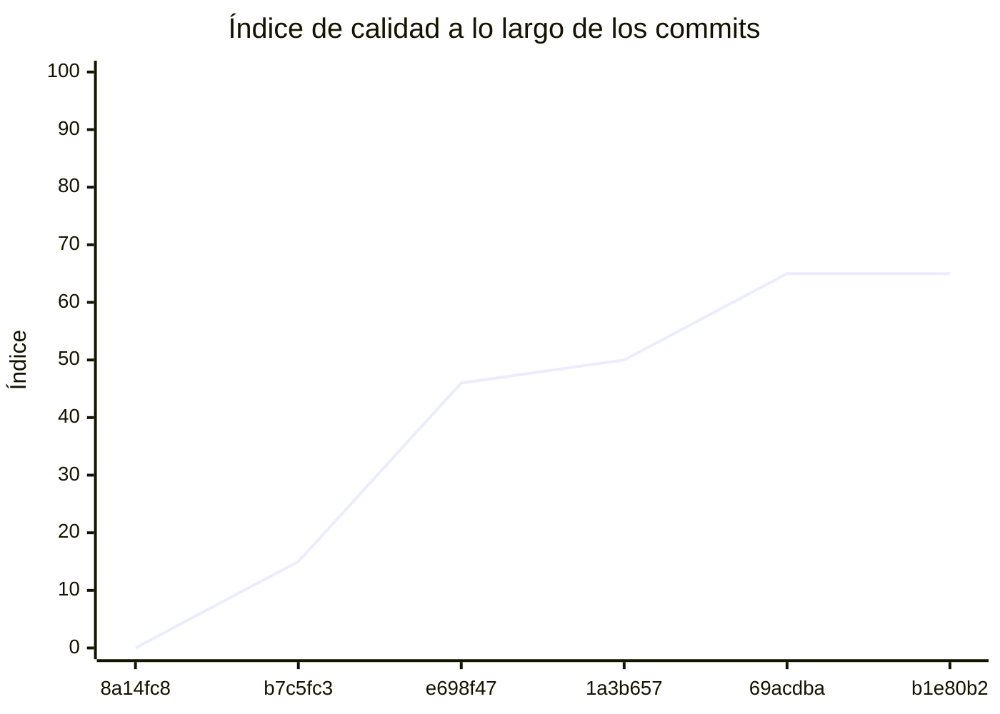

<!-- evaluacion:inicio -->
# Evaluación — prog2-yanez/servicio-turnos

> Documento **generado automáticamente** por la cátedra de Programación II (UM): RepoSense + análisis de calidad de **7 dimensiones**. **No editar a mano**: se regenera en cada evaluación.
> Rama evaluada: `main`. Análisis **heurístico** (regex + métricas) + build: es una criba para orientar la revisión, **no una nota**. La **documentación** del repositorio no se evalúa.
> Generado: 2026-11-12.

## 1. Veredicto

| Aspecto | Resultado |
|---|---|
| Índice de calidad | **76/100** |
| Tipo de repositorio | `backend` |
| Build (`mvnw verify` / `gradlew check`) | OK |
| Código (LOC) | 8,186 |
| Archivos de código | 202 |
| Clases | 220 |
| Código dentro de clases (%POO) | 76% |
| Funciones fuera de clases | 0 |
| Duplicación (puerta) | 0.4% |
| Duplicación lógica | 0.4% |
| Duplicación de boilerplate | 7.8% |
| Cobertura | 99% |
| Tope duro aplicado a D1 | `POO_BAJO` → D1 ≤ 60 |

> Este informe **describe** lo que el análisis midió con los criterios ya establecidos de la materia. No es una nota.

## 2. Semáforo de aprobación

Criterios de la cátedra (`CRITERIOS-CALIDAD.md`): **Aprobar** se juega con el perfil `estandar`; **destacar**, con el `exigente` (meta de excelencia).

| Semáforo | Resultado |
|---|---|
| Aprobar (`estandar`) | **no cumple** — 7/11 |
| Destacar (`exigente`) | **no cumple** — 6/11 |

**Para aprobar, falta cumplir:** SOLID

**Para destacar, falta cumplir:** SOLID; POO

## 3. Autoría (RepoSense)

| Autor | Commits | Código (LOC) | Tests (LOC) | Docs (LOC) | Días activos | % del código |
|---|---:|---:|---:|---:|---:|---:|
| Guadalupe Yañez | 86 | 4,548 | 5,277 | 734 | 15 | 100% |

> _El LOC de autoría lo calcula RepoSense sobre el historial y puede diferir del LOC de código del análisis (que mira el estado de `main`)._

## 4. Dimensiones evaluadas

Cada dimensión indica **qué mide**, **por qué importa** y **tu resultado**. Cuando el puntaje queda por debajo de la referencia, se agregan preguntas para **investigar la causa** (no hay recetas).

| Dimensión | Peso | Puntaje |
|:--|--:|--:|
| **D1** Diseño OO, SOLID y patrones (20%) | 20% | 2 |
| **D2** Arquitectura hexagonal — backend (15%) | 15% | 100 |
| **D3** Frontend KMP: MVVM y buenas prácticas (10%) | 10% | N/A |
| **D4** Integración y contrato (10%) | 10% | 80 |
| **D5** Seguridad y robustez (10%) | 10% | 100 |
| **D6** Pruebas y cobertura (20%) | 20% | 100 |
| **D7** Proceso y entrega (15%) | 15% | 100 |

### D1. Diseño OO, SOLID y patrones (20%)

- **Qué mide:** Métricas orientadas a objetos (clases, métodos, campos, cohesión, acoplamiento, herencia) y proxies de SOLID, más patrones de diseño.
- **Por qué importa:** El eje de la materia es el buen uso de la POO y su arquitectura: un diseño con clases claras y poco acopladas es más fácil de entender, probar y cambiar.
- **Tu resultado:** **2/100**
- **Para investigar la causa:**
    - ¿Se pensó el modelo de clases antes de codificar o se agrupó después?
    - ¿Qué clases concentran muchas responsabilidades a la vez?
    - ¿Los colaboradores llegan como parámetros o se crean por dentro?

### D2. Arquitectura hexagonal — backend (15%)

- **Qué mide:** Separación en capas (dominio, puertos de entrada/salida, adaptadores) y dirección de las dependencias del backend.
- **Por qué importa:** Aislar el dominio de la infraestructura permite cambiar la base de datos, el framework o el transporte sin tocar las reglas de negocio.
- **Tu resultado:** **100/100**

### D4. Integración y contrato (10%)

- **Qué mide:** Cumplimiento del contrato de integración de la cátedra (formato de errores, paginación, autenticación, endpoints esperados).
- **Por qué importa:** Los servicios deben poder integrarse entre sí y con la app sin sorpresas; el contrato es lo que hacen cumplir las pruebas de integración.
- **Tu resultado:** **80/100**

### D5. Seguridad y robustez (10%)

- **Qué mide:** Credenciales embebidas, consultas SQL por concatenación, y presencia de config de entorno; aislamiento de secretos.
- **Por qué importa:** Un secreto en el repositorio o una consulta construida por concatenación son riesgos concretos, no hipotéticos.
- **Tu resultado:** **100/100**

### D6. Pruebas y cobertura (20%)

- **Qué mide:** Cantidad y resultado de pruebas y cobertura de línea (JaCoCo/Kover, Surefire/Failsafe) cuando hay build.
- **Por qué importa:** Las pruebas son la red de seguridad para refactorizar e integrar; la cobertura acota las zonas sin verificar.
- **Tu resultado:** **100/100**

### D7. Proceso y entrega (15%)

- **Qué mide:** Artefactos verificables de proceso/entrega: `compose`, `.env.example`, CI (`.github/workflows/`), `CODEOWNERS` y wrapper de build (`mvnw`/`gradlew`). **No** puntúa documentación.
- **Por qué importa:** Un proyecto que compila, se levanta y se valida solo es más fácil de revisar y de integrar en equipo.
- **Tu resultado:** **100/100**

## 5. Señales detectadas

El análisis encontró las siguientes señales (archivo, sin número de línea a propósito):

**DIP/concretos** (113)
- clase 'EmisorTokensJwt' muy acoplada (CBO=14) — `src/main/java/prog2/servicioturnos/usuarios/infrastructure/seguridad/EmisorTokensJwt.java`
- clase 'CuentaController' muy acoplada (CBO=11) — `src/main/java/prog2/servicioturnos/usuarios/infrastructure/web/CuentaController.java`
- clase 'IniciarSesionService' muy acoplada (CBO=10) — `src/main/java/prog2/servicioturnos/usuarios/application/usecases/IniciarSesionService.java`
- clase 'RegistrarUsuarioService' muy acoplada (CBO=10) — `src/main/java/prog2/servicioturnos/usuarios/application/usecases/RegistrarUsuarioService.java`
- clase 'OcupacionesCatedraRestAdapter' muy acoplada (CBO=37) — `src/main/java/prog2/servicioturnos/disponibilidad/infrastructure/catedra/OcupacionesCatedraRestAdapter.java`
- clase 'OcupacionesCatedraRestAdapter' instancia 5 concretos (CBO=37) — `src/main/java/prog2/servicioturnos/disponibilidad/infrastructure/catedra/OcupacionesCatedraRestAdapter.java`
- clase 'CatalogoRestAdapter' muy acoplada (CBO=29) — `src/main/java/prog2/servicioturnos/disponibilidad/infrastructure/catalogo/CatalogoRestAdapter.java`
- clase 'CatalogoRestAdapter' instancia 7 concretos (CBO=29) — `src/main/java/prog2/servicioturnos/disponibilidad/infrastructure/catalogo/CatalogoRestAdapter.java`
- clase 'DisponibilidadController' muy acoplada (CBO=9) — `src/main/java/prog2/servicioturnos/disponibilidad/infrastructure/web/DisponibilidadController.java`
- clase 'ConsultarTurnosLibresService' muy acoplada (CBO=14) — `src/main/java/prog2/servicioturnos/disponibilidad/application/usecases/ConsultarTurnosLibresService.java`
- clase 'BuscarProfesionalesConTurnosLibresService' muy acoplada (CBO=17) — `src/main/java/prog2/servicioturnos/disponibilidad/application/usecases/BuscarProfesionalesConTurnosLibresService.java`
- clase 'CalculadoraTurnosLibres' muy acoplada (CBO=15) — `src/main/java/prog2/servicioturnos/disponibilidad/domain/service/CalculadoraTurnosLibres.java`
- clase 'CorsConfig' muy acoplada (CBO=27) — `src/main/java/prog2/servicioturnos/config/CorsConfig.java`
- clase 'CorsConfig' instancia 4 concretos (CBO=27) — `src/main/java/prog2/servicioturnos/config/CorsConfig.java`
- clase 'RechazoComoProblema' muy acoplada (CBO=12) — `src/main/java/prog2/servicioturnos/config/CorsConfig.java`
- clase 'JwtConfig' muy acoplada (CBO=14) — `src/main/java/prog2/servicioturnos/config/JwtConfig.java`
- clase 'CatedraConfig' muy acoplada (CBO=8) — `src/main/java/prog2/servicioturnos/config/CatedraConfig.java`
- clase 'SecurityConfig' muy acoplada (CBO=19) — `src/main/java/prog2/servicioturnos/config/SecurityConfig.java`
- clase 'LectorErrorCatedra' muy acoplada (CBO=10) — `src/main/java/prog2/servicioturnos/shared/catedra/LectorErrorCatedra.java`
- clase 'ManejadorErroresApi' muy acoplada (CBO=65) — `src/main/java/prog2/servicioturnos/shared/web/ManejadorErroresApi.java`
- clase 'ManejadorErroresApi' instancia 5 concretos (CBO=65) — `src/main/java/prog2/servicioturnos/shared/web/ManejadorErroresApi.java`
- clase 'HoldsCatedraRestAdapter' muy acoplada (CBO=39) — `src/main/java/prog2/servicioturnos/reservas/infrastructure/catedra/HoldsCatedraRestAdapter.java`
- clase 'HoldsCatedraRestAdapter' instancia 13 concretos (CBO=39) — `src/main/java/prog2/servicioturnos/reservas/infrastructure/catedra/HoldsCatedraRestAdapter.java`
- clase 'ReservasCatedraRestAdapter' muy acoplada (CBO=41) — `src/main/java/prog2/servicioturnos/reservas/infrastructure/catedra/ReservasCatedraRestAdapter.java`
- clase 'ReservasCatedraRestAdapter' instancia 9 concretos (CBO=41) — `src/main/java/prog2/servicioturnos/reservas/infrastructure/catedra/ReservasCatedraRestAdapter.java`
- clase 'ProcesoReservaPersistenceAdapter' muy acoplada (CBO=8) — `src/main/java/prog2/servicioturnos/reservas/infrastructure/persistence/ProcesoReservaPersistenceAdapter.java`
- clase 'JpaEventoProcesadoRepository' muy acoplada (CBO=11) — `src/main/java/prog2/servicioturnos/reservas/infrastructure/persistence/repository/JpaEventoProcesadoRepository.java`
- clase 'ProcesoReservaEntity' muy acoplada (CBO=8) — `src/main/java/prog2/servicioturnos/reservas/infrastructure/persistence/entity/ProcesoReservaEntity.java`
- clase 'AccionesCatedraListener' muy acoplada (CBO=18) — `src/main/java/prog2/servicioturnos/reservas/infrastructure/messaging/AccionesCatedraListener.java`
- clase 'KafkaConfig' muy acoplada (CBO=8) — `src/main/java/prog2/servicioturnos/reservas/infrastructure/messaging/KafkaConfig.java`
- clase 'PublicadorTelefonoKafka' muy acoplada (CBO=21) — `src/main/java/prog2/servicioturnos/reservas/infrastructure/messaging/PublicadorTelefonoKafka.java`
- clase 'PublicadorTelefonoKafka' instancia 3 concretos (CBO=21) — `src/main/java/prog2/servicioturnos/reservas/infrastructure/messaging/PublicadorTelefonoKafka.java`
- clase 'ReservaController' muy acoplada (CBO=22) — `src/main/java/prog2/servicioturnos/reservas/infrastructure/web/ReservaController.java`
- clase 'CancelarReservaService' muy acoplada (CBO=26) — `src/main/java/prog2/servicioturnos/reservas/application/usecases/CancelarReservaService.java`
- clase 'CancelarReservaService' instancia 4 concretos (CBO=26) — `src/main/java/prog2/servicioturnos/reservas/application/usecases/CancelarReservaService.java`
- clase 'RecuperarProcesosService' muy acoplada (CBO=28) — `src/main/java/prog2/servicioturnos/reservas/application/usecases/RecuperarProcesosService.java`
- clase 'ProcesarAccionesCatedraService' muy acoplada (CBO=15) — `src/main/java/prog2/servicioturnos/reservas/application/usecases/ProcesarAccionesCatedraService.java`
- clase 'ListarReservasPropiasService' muy acoplada (CBO=30) — `src/main/java/prog2/servicioturnos/reservas/application/usecases/ListarReservasPropiasService.java`
- clase 'ListarReservasPropiasService' instancia 4 concretos (CBO=30) — `src/main/java/prog2/servicioturnos/reservas/application/usecases/ListarReservasPropiasService.java`
- clase 'EnviarTelefonoService' muy acoplada (CBO=14) — `src/main/java/prog2/servicioturnos/reservas/application/usecases/EnviarTelefonoService.java`
- clase 'EnviarTelefonoService' instancia 4 concretos (CBO=14) — `src/main/java/prog2/servicioturnos/reservas/application/usecases/EnviarTelefonoService.java`
- clase 'IniciarReservaService' muy acoplada (CBO=26) — `src/main/java/prog2/servicioturnos/reservas/application/usecases/IniciarReservaService.java`
- clase 'IniciarReservaService' instancia 3 concretos (CBO=26) — `src/main/java/prog2/servicioturnos/reservas/application/usecases/IniciarReservaService.java`
- clase 'ReservasCatedra' muy acoplada (CBO=8) — `src/main/java/prog2/servicioturnos/reservas/domain/ports/out/ReservasCatedra.java`
- clase 'ProcesoReserva' muy acoplada (CBO=28) — `src/main/java/prog2/servicioturnos/reservas/domain/model/ProcesoReserva.java`
- clase 'ProcesoReserva' instancia 15 concretos (CBO=28) — `src/main/java/prog2/servicioturnos/reservas/domain/model/ProcesoReserva.java`
- clase 'EstadoProceso' muy acoplada (CBO=13) — `src/main/java/prog2/servicioturnos/reservas/domain/model/EstadoProceso.java`
- clase 'CorsIntegracionTests' muy acoplada (CBO=24) — `src/test/java/prog2/servicioturnos/CorsIntegracionTests.java`
- clase 'SeguridadIntegracionTests' muy acoplada (CBO=31) — `src/test/java/prog2/servicioturnos/SeguridadIntegracionTests.java`
- clase 'EmisorTokensJwtTests' muy acoplada (CBO=21) — `src/test/java/prog2/servicioturnos/usuarios/infrastructure/seguridad/EmisorTokensJwtTests.java`
- clase 'EmisorTokensJwtTests' instancia 5 concretos (CBO=21) — `src/test/java/prog2/servicioturnos/usuarios/infrastructure/seguridad/EmisorTokensJwtTests.java`
- clase 'UsuarioPersistenciaTests' muy acoplada (CBO=8) — `src/test/java/prog2/servicioturnos/usuarios/infrastructure/persistence/UsuarioPersistenciaTests.java`
- clase 'CuentaControllerTests' muy acoplada (CBO=35) — `src/test/java/prog2/servicioturnos/usuarios/infrastructure/web/CuentaControllerTests.java`
- clase 'CuentaControllerTests' instancia 15 concretos (CBO=35) — `src/test/java/prog2/servicioturnos/usuarios/infrastructure/web/CuentaControllerTests.java`
- clase 'ConsultarCuentaServiceTests' muy acoplada (CBO=9) — `src/test/java/prog2/servicioturnos/usuarios/application/usecases/ConsultarCuentaServiceTests.java`
- clase 'IniciarSesionServiceTests' muy acoplada (CBO=14) — `src/test/java/prog2/servicioturnos/usuarios/application/usecases/IniciarSesionServiceTests.java`
- clase 'IniciarSesionServiceTests' instancia 7 concretos (CBO=14) — `src/test/java/prog2/servicioturnos/usuarios/application/usecases/IniciarSesionServiceTests.java`
- clase 'RegistrarUsuarioServiceTests' muy acoplada (CBO=18) — `src/test/java/prog2/servicioturnos/usuarios/application/usecases/RegistrarUsuarioServiceTests.java`
- clase 'RegistrarUsuarioServiceTests' instancia 3 concretos (CBO=18) — `src/test/java/prog2/servicioturnos/usuarios/application/usecases/RegistrarUsuarioServiceTests.java`
- clase 'UsuarioTests' muy acoplada (CBO=15) — `src/test/java/prog2/servicioturnos/usuarios/domain/model/UsuarioTests.java`
- clase 'UsuarioTests' instancia 4 concretos (CBO=15) — `src/test/java/prog2/servicioturnos/usuarios/domain/model/UsuarioTests.java`
- clase 'OcupacionesCatedraRestAdapterTests' muy acoplada (CBO=39) — `src/test/java/prog2/servicioturnos/disponibilidad/infrastructure/catedra/OcupacionesCatedraRestAdapterTests.java`
- clase 'OcupacionesCatedraRestAdapterTests' instancia 5 concretos (CBO=39) — `src/test/java/prog2/servicioturnos/disponibilidad/infrastructure/catedra/OcupacionesCatedraRestAdapterTests.java`
- clase 'CatalogoRestAdapterTests' muy acoplada (CBO=38) — `src/test/java/prog2/servicioturnos/disponibilidad/infrastructure/catalogo/CatalogoRestAdapterTests.java`
- clase 'CatalogoRestAdapterTests' instancia 8 concretos (CBO=38) — `src/test/java/prog2/servicioturnos/disponibilidad/infrastructure/catalogo/CatalogoRestAdapterTests.java`
- clase 'DisponibilidadControllerTests' muy acoplada (CBO=29) — `src/test/java/prog2/servicioturnos/disponibilidad/infrastructure/web/DisponibilidadControllerTests.java`
- clase 'DisponibilidadControllerTests' instancia 7 concretos (CBO=29) — `src/test/java/prog2/servicioturnos/disponibilidad/infrastructure/web/DisponibilidadControllerTests.java`
- clase 'BuscarProfesionalesConTurnosLibresServiceTests' muy acoplada (CBO=29) — `src/test/java/prog2/servicioturnos/disponibilidad/application/usecases/BuscarProfesionalesConTurnosLibresServiceTests.java`
- clase 'BuscarProfesionalesConTurnosLibresServiceTests' instancia 14 concretos (CBO=29) — `src/test/java/prog2/servicioturnos/disponibilidad/application/usecases/BuscarProfesionalesConTurnosLibresServiceTests.java`
- clase 'ConsultarTurnosLibresServiceTests' muy acoplada (CBO=28) — `src/test/java/prog2/servicioturnos/disponibilidad/application/usecases/ConsultarTurnosLibresServiceTests.java`
- clase 'ConsultarTurnosLibresServiceTests' instancia 7 concretos (CBO=28) — `src/test/java/prog2/servicioturnos/disponibilidad/application/usecases/ConsultarTurnosLibresServiceTests.java`
- clase 'CalculadoraTurnosLibresTests' muy acoplada (CBO=22) — `src/test/java/prog2/servicioturnos/disponibilidad/domain/service/CalculadoraTurnosLibresTests.java`
- clase 'CalculadoraTurnosLibresTests' instancia 8 concretos (CBO=22) — `src/test/java/prog2/servicioturnos/disponibilidad/domain/service/CalculadoraTurnosLibresTests.java`
- clase 'ManejadorErroresApiTests' muy acoplada (CBO=39) — `src/test/java/prog2/servicioturnos/shared/web/ManejadorErroresApiTests.java`
- clase 'ManejadorErroresApiTests' instancia 8 concretos (CBO=39) — `src/test/java/prog2/servicioturnos/shared/web/ManejadorErroresApiTests.java`
- clase 'CuentasPacientesAdapterTests' muy acoplada (CBO=8) — `src/test/java/prog2/servicioturnos/reservas/infrastructure/usuarios/CuentasPacientesAdapterTests.java`
- clase 'CuentasPacientesAdapterTests' instancia 4 concretos (CBO=8) — `src/test/java/prog2/servicioturnos/reservas/infrastructure/usuarios/CuentasPacientesAdapterTests.java`
- clase 'HoldsCatedraRestAdapterTests' muy acoplada (CBO=46) — `src/test/java/prog2/servicioturnos/reservas/infrastructure/catedra/HoldsCatedraRestAdapterTests.java`
- clase 'HoldsCatedraRestAdapterTests' instancia 4 concretos (CBO=46) — `src/test/java/prog2/servicioturnos/reservas/infrastructure/catedra/HoldsCatedraRestAdapterTests.java`
- clase 'ReservasCatedraRestAdapterTests' muy acoplada (CBO=51) — `src/test/java/prog2/servicioturnos/reservas/infrastructure/catedra/ReservasCatedraRestAdapterTests.java`
- clase 'ReservasCatedraRestAdapterTests' instancia 5 concretos (CBO=51) — `src/test/java/prog2/servicioturnos/reservas/infrastructure/catedra/ReservasCatedraRestAdapterTests.java`
- clase 'RecuperacionProgramadaTests' muy acoplada (CBO=10) — `src/test/java/prog2/servicioturnos/reservas/infrastructure/recuperacion/RecuperacionProgramadaTests.java`
- clase 'RecuperacionProgramadaTests' instancia 6 concretos (CBO=10) — `src/test/java/prog2/servicioturnos/reservas/infrastructure/recuperacion/RecuperacionProgramadaTests.java`
- clase 'ProcesoReservaPersistenciaTests' muy acoplada (CBO=14) — `src/test/java/prog2/servicioturnos/reservas/infrastructure/persistence/ProcesoReservaPersistenciaTests.java`
- clase 'AccionesCatedraListenerTests' muy acoplada (CBO=17) — `src/test/java/prog2/servicioturnos/reservas/infrastructure/messaging/AccionesCatedraListenerTests.java`
- clase 'AccionesCatedraListenerTests' instancia 7 concretos (CBO=17) — `src/test/java/prog2/servicioturnos/reservas/infrastructure/messaging/AccionesCatedraListenerTests.java`
- clase 'PublicadorTelefonoKafkaTests' muy acoplada (CBO=17) — `src/test/java/prog2/servicioturnos/reservas/infrastructure/messaging/PublicadorTelefonoKafkaTests.java`
- clase 'PublicadorTelefonoKafkaTests' instancia 7 concretos (CBO=17) — `src/test/java/prog2/servicioturnos/reservas/infrastructure/messaging/PublicadorTelefonoKafkaTests.java`
- clase 'TelefonoKafkaIntegracionTests' muy acoplada (CBO=36) — `src/test/java/prog2/servicioturnos/reservas/infrastructure/messaging/TelefonoKafkaIntegracionTests.java`
- clase 'TelefonoKafkaIntegracionTests' instancia 3 concretos (CBO=36) — `src/test/java/prog2/servicioturnos/reservas/infrastructure/messaging/TelefonoKafkaIntegracionTests.java`
- clase 'ResultadosKafkaIntegracionTests' muy acoplada (CBO=23) — `src/test/java/prog2/servicioturnos/reservas/infrastructure/messaging/ResultadosKafkaIntegracionTests.java`
- clase 'ReservaControllerTests' muy acoplada (CBO=47) — `src/test/java/prog2/servicioturnos/reservas/infrastructure/web/ReservaControllerTests.java`
- clase 'ReservaControllerTests' instancia 17 concretos (CBO=47) — `src/test/java/prog2/servicioturnos/reservas/infrastructure/web/ReservaControllerTests.java`
- clase 'CancelarReservaServiceTests' muy acoplada (CBO=34) — `src/test/java/prog2/servicioturnos/reservas/application/usecases/CancelarReservaServiceTests.java`
- clase 'CancelarReservaServiceTests' instancia 11 concretos (CBO=34) — `src/test/java/prog2/servicioturnos/reservas/application/usecases/CancelarReservaServiceTests.java`
- clase 'IniciarReservaServiceTests' muy acoplada (CBO=37) — `src/test/java/prog2/servicioturnos/reservas/application/usecases/IniciarReservaServiceTests.java`
- clase 'IniciarReservaServiceTests' instancia 19 concretos (CBO=37) — `src/test/java/prog2/servicioturnos/reservas/application/usecases/IniciarReservaServiceTests.java`
- clase 'RecuperarProcesosServiceTests' muy acoplada (CBO=39) — `src/test/java/prog2/servicioturnos/reservas/application/usecases/RecuperarProcesosServiceTests.java`
- clase 'RecuperarProcesosServiceTests' instancia 9 concretos (CBO=39) — `src/test/java/prog2/servicioturnos/reservas/application/usecases/RecuperarProcesosServiceTests.java`
- clase 'ListarReservasPropiasServiceTests' muy acoplada (CBO=29) — `src/test/java/prog2/servicioturnos/reservas/application/usecases/ListarReservasPropiasServiceTests.java`
- clase 'ListarReservasPropiasServiceTests' instancia 7 concretos (CBO=29) — `src/test/java/prog2/servicioturnos/reservas/application/usecases/ListarReservasPropiasServiceTests.java`
- clase 'EnviarTelefonoServiceTests' muy acoplada (CBO=27) — `src/test/java/prog2/servicioturnos/reservas/application/usecases/EnviarTelefonoServiceTests.java`
- clase 'EnviarTelefonoServiceTests' instancia 6 concretos (CBO=27) — `src/test/java/prog2/servicioturnos/reservas/application/usecases/EnviarTelefonoServiceTests.java`
- clase 'ProcesarResultadosServiceTests' muy acoplada (CBO=25) — `src/test/java/prog2/servicioturnos/reservas/application/usecases/ProcesarResultadosServiceTests.java`
- clase 'ProcesarResultadosServiceTests' instancia 6 concretos (CBO=25) — `src/test/java/prog2/servicioturnos/reservas/application/usecases/ProcesarResultadosServiceTests.java`
- clase 'ConsultarProcesoServiceTests' muy acoplada (CBO=17) — `src/test/java/prog2/servicioturnos/reservas/application/usecases/ConsultarProcesoServiceTests.java`
- clase 'ConsultarProcesoServiceTests' instancia 4 concretos (CBO=17) — `src/test/java/prog2/servicioturnos/reservas/application/usecases/ConsultarProcesoServiceTests.java`
- clase 'ProcesarAccionesCatedraServiceTests' muy acoplada (CBO=18) — `src/test/java/prog2/servicioturnos/reservas/application/usecases/ProcesarAccionesCatedraServiceTests.java`
- clase 'ProcesarAccionesCatedraServiceTests' instancia 4 concretos (CBO=18) — `src/test/java/prog2/servicioturnos/reservas/application/usecases/ProcesarAccionesCatedraServiceTests.java`
- clase 'ProcesoReservaTests' muy acoplada (CBO=13) — `src/test/java/prog2/servicioturnos/reservas/domain/model/ProcesoReservaTests.java`
- clase 'ProcesoReservaTests' instancia 5 concretos (CBO=13) — `src/test/java/prog2/servicioturnos/reservas/domain/model/ProcesoReservaTests.java`
- clase 'ProcesoReservaTelefonoTests' muy acoplada (CBO=9) — `src/test/java/prog2/servicioturnos/reservas/domain/model/ProcesoReservaTelefonoTests.java`
- clase 'ProcesoReservaResultadoTests' muy acoplada (CBO=12) — `src/test/java/prog2/servicioturnos/reservas/domain/model/ProcesoReservaResultadoTests.java`

**SRP/responsabilidad** (55)
- clase 'UsuarioEntity' grande (LOC=34, métodos=0, campos=14) — `src/main/java/prog2/servicioturnos/usuarios/infrastructure/persistence/entity/UsuarioEntity.java`
- clase 'UsuarioEntity' sin métodos (14 campos): solo datos — `src/main/java/prog2/servicioturnos/usuarios/infrastructure/persistence/entity/UsuarioEntity.java`
- clase 'OcupacionesCatedraRestAdapter' con baja cohesión (8%) — `src/main/java/prog2/servicioturnos/disponibilidad/infrastructure/catedra/OcupacionesCatedraRestAdapter.java`
- clase 'CatalogoRestAdapter' grande (LOC=101, métodos=16, campos=6) — `src/main/java/prog2/servicioturnos/disponibilidad/infrastructure/catalogo/CatalogoRestAdapter.java`
- clase 'CatalogoRestAdapter' con baja cohesión (5%) — `src/main/java/prog2/servicioturnos/disponibilidad/infrastructure/catalogo/CatalogoRestAdapter.java`
- método 'ProfesionalConTurnosLibres.ProfesionalConTurnosLibres' con 5 parámetros — `src/main/java/prog2/servicioturnos/disponibilidad/domain/model/ProfesionalConTurnosLibres.java`
- clase 'ManejadorErroresApi' grande (LOC=175, métodos=12, campos=5) — `src/main/java/prog2/servicioturnos/shared/web/ManejadorErroresApi.java`
- clase 'ManejadorErroresApi' con baja cohesión (0%) — `src/main/java/prog2/servicioturnos/shared/web/ManejadorErroresApi.java`
- clase 'HoldsCatedraRestAdapter' grande (LOC=73, métodos=10, campos=5) — `src/main/java/prog2/servicioturnos/reservas/infrastructure/catedra/HoldsCatedraRestAdapter.java`
- clase 'HoldsCatedraRestAdapter' con baja cohesión (9%) — `src/main/java/prog2/servicioturnos/reservas/infrastructure/catedra/HoldsCatedraRestAdapter.java`
- método 'HoldsCatedraRestAdapter.traducirError' con complejidad 6 — `src/main/java/prog2/servicioturnos/reservas/infrastructure/catedra/HoldsCatedraRestAdapter.java`
- clase 'ReservasCatedraRestAdapter' grande (LOC=138, métodos=18, campos=8) — `src/main/java/prog2/servicioturnos/reservas/infrastructure/catedra/ReservasCatedraRestAdapter.java`
- clase 'ReservasCatedraRestAdapter' con baja cohesión (15%) — `src/main/java/prog2/servicioturnos/reservas/infrastructure/catedra/ReservasCatedraRestAdapter.java`
- método 'ReservasCatedraRestAdapter.deUnPaciente' con complejidad 6 — `src/main/java/prog2/servicioturnos/reservas/infrastructure/catedra/ReservasCatedraRestAdapter.java`
- clase 'EventoProcesadoEntity' sin métodos (3 campos): solo datos — `src/main/java/prog2/servicioturnos/reservas/infrastructure/persistence/entity/EventoProcesadoEntity.java`
- clase 'ProcesoReservaEntity' grande (LOC=34, métodos=0, campos=15) — `src/main/java/prog2/servicioturnos/reservas/infrastructure/persistence/entity/ProcesoReservaEntity.java`
- clase 'ProcesoReservaEntity' sin métodos (15 campos): solo datos — `src/main/java/prog2/servicioturnos/reservas/infrastructure/persistence/entity/ProcesoReservaEntity.java`
- clase 'AccionesCatedraListener' grande (LOC=44, métodos=3, campos=9) — `src/main/java/prog2/servicioturnos/reservas/infrastructure/messaging/AccionesCatedraListener.java`
- método 'AccionesCatedraListener.recibir' con complejidad 9 — `src/main/java/prog2/servicioturnos/reservas/infrastructure/messaging/AccionesCatedraListener.java`
- método 'AccionesCatedraListener.EventoCatedra' con complejidad 7 — `src/main/java/prog2/servicioturnos/reservas/infrastructure/messaging/AccionesCatedraListener.java`
- clase 'CancelarReservaService' con baja cohesión (47%) — `src/main/java/prog2/servicioturnos/reservas/application/usecases/CancelarReservaService.java`
- clase 'RecuperarProcesosService' grande (LOC=99, métodos=10, campos=6) — `src/main/java/prog2/servicioturnos/reservas/application/usecases/RecuperarProcesosService.java`
- clase 'RecuperarProcesosService' con baja cohesión (33%) — `src/main/java/prog2/servicioturnos/reservas/application/usecases/RecuperarProcesosService.java`
- clase 'ListarReservasPropiasService' grande (LOC=75, métodos=10, campos=6) — `src/main/java/prog2/servicioturnos/reservas/application/usecases/ListarReservasPropiasService.java`
- clase 'ListarReservasPropiasService' con baja cohesión (2%) — `src/main/java/prog2/servicioturnos/reservas/application/usecases/ListarReservasPropiasService.java`
- clase 'IniciarReservaService' con baja cohesión (10%) — `src/main/java/prog2/servicioturnos/reservas/application/usecases/IniciarReservaService.java`
- método 'IniciarReservaService.iniciar' de 32 líneas — `src/main/java/prog2/servicioturnos/reservas/application/usecases/IniciarReservaService.java`
- método 'IniciarReservaService.iniciar' con complejidad 6 — `src/main/java/prog2/servicioturnos/reservas/application/usecases/IniciarReservaService.java`
- clase 'ProcesoReserva' grande (LOC=148, métodos=20, campos=2) — `src/main/java/prog2/servicioturnos/reservas/domain/model/ProcesoReserva.java`
- clase 'SeguridadIntegracionTests' grande (LOC=85, métodos=13, campos=2) — `src/test/java/prog2/servicioturnos/SeguridadIntegracionTests.java`
- método 'SeguridadIntegracionTests.firmar' con 5 parámetros — `src/test/java/prog2/servicioturnos/SeguridadIntegracionTests.java`
- clase 'EmisorTokensJwtTests' con baja cohesión (33%) — `src/test/java/prog2/servicioturnos/usuarios/infrastructure/seguridad/EmisorTokensJwtTests.java`
- clase 'CuentaControllerTests' grande (LOC=185, métodos=23, campos=4) — `src/test/java/prog2/servicioturnos/usuarios/infrastructure/web/CuentaControllerTests.java`
- clase 'CuentaControllerTests' con baja cohesión (19%) — `src/test/java/prog2/servicioturnos/usuarios/infrastructure/web/CuentaControllerTests.java`
- clase 'OcupacionesCatedraRestAdapterTests' grande (LOC=130, métodos=18, campos=6) — `src/test/java/prog2/servicioturnos/disponibilidad/infrastructure/catedra/OcupacionesCatedraRestAdapterTests.java`
- clase 'CatalogoRestAdapterTests' grande (LOC=144, métodos=20, campos=7) — `src/test/java/prog2/servicioturnos/disponibilidad/infrastructure/catalogo/CatalogoRestAdapterTests.java`
- clase 'DisponibilidadControllerTests' grande (LOC=105, métodos=13, campos=4) — `src/test/java/prog2/servicioturnos/disponibilidad/infrastructure/web/DisponibilidadControllerTests.java`
- clase 'DisponibilidadControllerTests' con baja cohesión (46%) — `src/test/java/prog2/servicioturnos/disponibilidad/infrastructure/web/DisponibilidadControllerTests.java`
- clase 'CalculadoraTurnosLibresTests' grande (LOC=114, métodos=15, campos=4) — `src/test/java/prog2/servicioturnos/disponibilidad/domain/service/CalculadoraTurnosLibresTests.java`
- clase 'ManejadorErroresApiTests' grande (LOC=197, métodos=34, campos=1) — `src/test/java/prog2/servicioturnos/shared/web/ManejadorErroresApiTests.java`
- clase 'ControladorDePrueba' grande (LOC=46, métodos=11, campos=0) — `src/test/java/prog2/servicioturnos/shared/web/ManejadorErroresApiTests.java`
- clase 'RepositorioProcesosEnMemoria' grande (LOC=65, métodos=11, campos=3) — `src/test/java/prog2/servicioturnos/reservas/RepositorioProcesosEnMemoria.java`
- clase 'RepositorioProcesosEnMemoria' con baja cohesión (40%) — `src/test/java/prog2/servicioturnos/reservas/RepositorioProcesosEnMemoria.java`
- clase 'HoldsCatedraRestAdapterTests' grande (LOC=118, métodos=20, campos=7) — `src/test/java/prog2/servicioturnos/reservas/infrastructure/catedra/HoldsCatedraRestAdapterTests.java`
- clase 'HoldsCatedraRestAdapterTests' con baja cohesión (37%) — `src/test/java/prog2/servicioturnos/reservas/infrastructure/catedra/HoldsCatedraRestAdapterTests.java`
- clase 'ReservasCatedraRestAdapterTests' grande (LOC=159, métodos=18, campos=7) — `src/test/java/prog2/servicioturnos/reservas/infrastructure/catedra/ReservasCatedraRestAdapterTests.java`
- clase 'ProcesoReservaPersistenciaTests' grande (LOC=74, métodos=10, campos=5) — `src/test/java/prog2/servicioturnos/reservas/infrastructure/persistence/ProcesoReservaPersistenciaTests.java`
- clase 'TelefonoKafkaIntegracionTests' grande (LOC=87, métodos=7, campos=13) — `src/test/java/prog2/servicioturnos/reservas/infrastructure/messaging/TelefonoKafkaIntegracionTests.java`
- clase 'ResultadosKafkaIntegracionTests' grande (LOC=59, métodos=5, campos=9) — `src/test/java/prog2/servicioturnos/reservas/infrastructure/messaging/ResultadosKafkaIntegracionTests.java`
- clase 'ReservaControllerTests' grande (LOC=255, métodos=39, campos=8) — `src/test/java/prog2/servicioturnos/reservas/infrastructure/web/ReservaControllerTests.java`
- clase 'ReservaControllerTests' con baja cohesión (30%) — `src/test/java/prog2/servicioturnos/reservas/infrastructure/web/ReservaControllerTests.java`
- clase 'CancelarReservaServiceTests' grande (LOC=115, métodos=12, campos=8) — `src/test/java/prog2/servicioturnos/reservas/application/usecases/CancelarReservaServiceTests.java`
- clase 'IniciarReservaServiceTests' grande (LOC=100, métodos=11, campos=11) — `src/test/java/prog2/servicioturnos/reservas/application/usecases/IniciarReservaServiceTests.java`
- clase 'RecuperarProcesosServiceTests' grande (LOC=145, métodos=16, campos=5) — `src/test/java/prog2/servicioturnos/reservas/application/usecases/RecuperarProcesosServiceTests.java`
- clase 'ListarReservasPropiasServiceTests' grande (LOC=117, métodos=12, campos=6) — `src/test/java/prog2/servicioturnos/reservas/application/usecases/ListarReservasPropiasServiceTests.java`

**?** (31)
- clase 'LoginRepetidoException' con herencia profunda (DIT=3) — `src/main/java/prog2/servicioturnos/usuarios/domain/exception/LoginRepetidoException.java`
- clase 'EmailRepetidoException' con herencia profunda (DIT=3) — `src/main/java/prog2/servicioturnos/usuarios/domain/exception/EmailRepetidoException.java`
- clase 'CredencialesInvalidasException' con herencia profunda (DIT=3) — `src/main/java/prog2/servicioturnos/usuarios/domain/exception/CredencialesInvalidasException.java`
- clase 'CuentaNoEncontradaException' con herencia profunda (DIT=3) — `src/main/java/prog2/servicioturnos/usuarios/domain/exception/CuentaNoEncontradaException.java`
- clase 'ProfesionalNoEncontradoException' con herencia profunda (DIT=3) — `src/main/java/prog2/servicioturnos/disponibilidad/domain/exception/ProfesionalNoEncontradoException.java`
- clase 'CatedraNoDisponibleException' con herencia profunda (DIT=3) — `src/main/java/prog2/servicioturnos/disponibilidad/domain/exception/CatedraNoDisponibleException.java`
- clase 'CatalogoNoDisponibleException' con herencia profunda (DIT=3) — `src/main/java/prog2/servicioturnos/disponibilidad/domain/exception/CatalogoNoDisponibleException.java`
- clase 'FechaPasadaException' con herencia profunda (DIT=3) — `src/main/java/prog2/servicioturnos/disponibilidad/domain/exception/FechaPasadaException.java`
- clase 'ProfesionalDeshabilitadoException' con herencia profunda (DIT=3) — `src/main/java/prog2/servicioturnos/disponibilidad/domain/exception/ProfesionalDeshabilitadoException.java`
- clase 'ServicioNoDisponibleException' con herencia profunda (DIT=2) — `src/main/java/prog2/servicioturnos/shared/exception/ServicioNoDisponibleException.java`
- clase 'PedidoInvalidoException' con herencia profunda (DIT=2) — `src/main/java/prog2/servicioturnos/shared/exception/PedidoInvalidoException.java`
- clase 'ConflictoException' con herencia profunda (DIT=2) — `src/main/java/prog2/servicioturnos/shared/exception/ConflictoException.java`
- clase 'NoAutenticadoException' con herencia profunda (DIT=2) — `src/main/java/prog2/servicioturnos/shared/exception/NoAutenticadoException.java`
- clase 'RecursoNoEncontradoException' con herencia profunda (DIT=2) — `src/main/java/prog2/servicioturnos/shared/exception/RecursoNoEncontradoException.java`
- clase 'TelefonoNoPedidoException' con herencia profunda (DIT=3) — `src/main/java/prog2/servicioturnos/reservas/domain/exception/TelefonoNoPedidoException.java`
- clase 'DatosDeCuentaIncompletosException' con herencia profunda (DIT=3) — `src/main/java/prog2/servicioturnos/reservas/domain/exception/DatosDeCuentaIncompletosException.java`
- clase 'ProcesoNoEncontradoException' con herencia profunda (DIT=3) — `src/main/java/prog2/servicioturnos/reservas/domain/exception/ProcesoNoEncontradoException.java`
- clase 'EnvioNoConfirmadoException' con herencia profunda (DIT=3) — `src/main/java/prog2/servicioturnos/reservas/domain/exception/EnvioNoConfirmadoException.java`
- clase 'TurnoNoDisponibleException' con herencia profunda (DIT=3) — `src/main/java/prog2/servicioturnos/reservas/domain/exception/TurnoNoDisponibleException.java`
- clase 'CancelacionNoConfirmadaException' con herencia profunda (DIT=3) — `src/main/java/prog2/servicioturnos/reservas/domain/exception/CancelacionNoConfirmadaException.java`
- clase 'TurnoOcupadoException' con herencia profunda (DIT=3) — `src/main/java/prog2/servicioturnos/reservas/domain/exception/TurnoOcupadoException.java`
- clase 'TelefonoInvalidoException' con herencia profunda (DIT=3) — `src/main/java/prog2/servicioturnos/reservas/domain/exception/TelefonoInvalidoException.java`
- clase 'SinProcesoEnCursoException' con herencia profunda (DIT=3) — `src/main/java/prog2/servicioturnos/reservas/domain/exception/SinProcesoEnCursoException.java`
- clase 'ProcesoVencidoException' con herencia profunda (DIT=3) — `src/main/java/prog2/servicioturnos/reservas/domain/exception/ProcesoVencidoException.java`
- clase 'ReservaNoCancelableException' con herencia profunda (DIT=3) — `src/main/java/prog2/servicioturnos/reservas/domain/exception/ReservaNoCancelableException.java`
- clase 'ReservaRechazadaException' con herencia profunda (DIT=3) — `src/main/java/prog2/servicioturnos/reservas/domain/exception/ReservaRechazadaException.java`
- clase 'ProcesoAbiertoException' con herencia profunda (DIT=3) — `src/main/java/prog2/servicioturnos/reservas/domain/exception/ProcesoAbiertoException.java`
- clase 'ProcesoNoEncontradoException' con herencia profunda (DIT=3) — `src/test/java/prog2/servicioturnos/shared/web/ManejadorErroresApiTests.java`
- clase 'CredencialesDePruebaException' con herencia profunda (DIT=3) — `src/test/java/prog2/servicioturnos/shared/web/ManejadorErroresApiTests.java`
- clase 'LoginRepetidoException' con herencia profunda (DIT=3) — `src/test/java/prog2/servicioturnos/shared/web/ManejadorErroresApiTests.java`
- clase 'CatalogoDePruebaNoDisponibleException' con herencia profunda (DIT=3) — `src/test/java/prog2/servicioturnos/shared/web/ManejadorErroresApiTests.java`

**OCP/type-switch** (2)
- clase 'CatalogoRestAdapter' con 1 type-checks — `src/main/java/prog2/servicioturnos/disponibilidad/infrastructure/catalogo/CatalogoRestAdapter.java`
- clase 'ManejadorErroresApi' con 3 type-checks — `src/main/java/prog2/servicioturnos/shared/web/ManejadorErroresApi.java`

## 6. Evolución por commit

Métricas calculadas sobre el estado de `main` en **cada commit** (6 commits con trabajo), del primero al último. La calidad usa el perfil `exigente`; el aporte de código lo mide RepoSense. El índice puede **bajar** al crecer el proyecto: se acumulan señales.

| # | Fecha | Commit | Autor | LOC | Índice | %POO | Duplic. | Sueltas |
|---|---|---|---|---:|---:|---:|---:|---:|
| 1 | 2026-09-10 | `8a14fc8` | Ing. Daniel Quinteros | 0 | 0 | 0% | 0.0% | 0 |
| 2 | 2026-09-10 | `b7c5fc3` | Ing. Daniel Quinteros | 0 | 15 | 0% | 0.0% | 0 |
| 3 | 2026-10-12 | `e698f47` | Guadalupe Yañez | 0 | 46 | 0% | 0.0% | 0 |
| 4 | 2026-10-29 | `1a3b657` | Guadalupe Yañez | 89 | 50 | 53% | 0.0% | 0 |
| 5 | 2026-11-07 | `69acdba` | Guadalupe Yañez | 8,136 | 65 | 76% | 0.4% | 0 |
| 6 | 2026-11-10 | `b1e80b2` | Guadalupe Yañez | 8,186 | 65 | 76% | 0.4% | 0 |

---
_Informe generado por la cátedra. Las dimensiones y umbrales corresponden a `calidad.py` (perfil `exigente`); el semáforo, a `CRITERIOS-CALIDAD.md`. La documentación del repositorio no se evalúa. Ante dudas, revisá el archivo señalado._
<!-- evaluacion:fin -->
